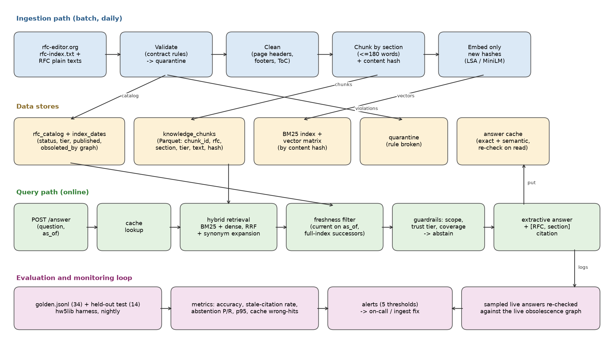
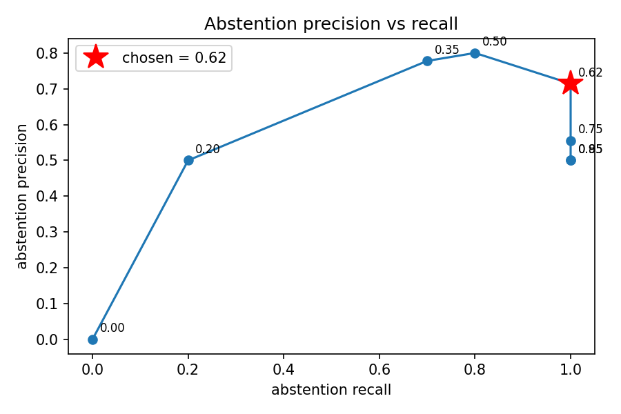
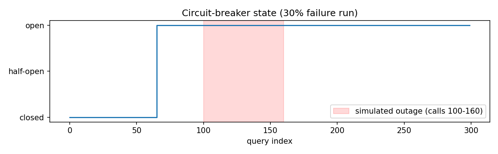

# Freshness-aware RAG: data systems for grounded Q&A

Two retrieval-augmented Q&A systems built around one problem that most RAG demos ignore: **documents go out of date**. A help-center policy gets a new version, or an internet standard gets obsoleted by a newer RFC, and the system has to answer from what is current *on the date asked*, cite it, and say "not covered" instead of guessing.

| | **RFC Assistant** (`rfc_assistant/`) | **Northbeam support assistant** (repo root) |
|---|---|---|
| Corpus | 240 real IETF RFCs + the full RFC index (9,377 chunks) | Synthetic retailer help center, 2,400 support tickets, change-event stream |
| Users | Protocol engineers asking "what does the *current* spec say?" | Customers asking about returns, shipping, accounts |
| Main failure mode | Quoting an obsolete RFC | Quoting a superseded policy version, leaking PII |
| Stack | pandas, scikit-learn, BM25, Parquet | PySpark, scikit-learn, BM25, Parquet |

Both run on a CPU, with no paid API and no model download.



## RFC Assistant

Ask a protocol question for a given date and get back a quoted sentence with `[RFC n, section]`, or an explicit abstention. RFCs are never edited, only replaced ("obsoleted by"), so the same question has different correct answers on different dates. For example, HTTP 413 was "Request Entity Too Large" in RFC 2616 but is "Content Too Large" in RFC 9110.

**How it works**
- **Ingestion:** validation and quarantine (9 malformed RFCs rejected), cleaning, section-level chunking, and a freshness rule that dates every RFC's successors from the *full* RFC index, not just the corpus.
- **Retrieval:** BM25 + LSA hybrid restricted to RFCs current on the query date, with source tiers and a scope guard.
- **Answering:** extractive sentence scoring with citations, and abstention when coverage is low, the only source is an April-1st joke RFC, or the only source has been obsoleted by an RFC outside the corpus.
- **Production pattern:** a two-tier (exact + semantic) answer cache that re-checks on every read that cited RFCs are still current.

**Results** (34-question golden set written before the system was run, plus a 14-question held-out set frozen by hash and evaluated once)

| System | Golden acc. | Stale-citation rate | Abstention P / R | Held-out acc. | Held-out stale rate |
|---|---|---|---|---|---|
| BM25 baseline | 0.147 | 0.412 | – / 0.0 | 0.143 | 0.357 |
| v1 | 0.500 | 0.083 | 0.80 / 0.80 | 0.429 | 0.091 |
| **v2 (final)** | **0.618** | **0.000** | **0.91 / 1.00** | **0.500** | **0.000** |

- **Zero stale citations** on both sets. The key change was dating successors from the full RFC index: with only in-corpus successors the system still quoted RFC 793 (TCP) and RFC 8446 (TLS 1.3) after they were obsoleted.
- **Ablations:** removing the freshness filter costs 0.147 accuracy and pushes the stale rate to 0.375; removing the scope guard costs 0.118. Other components cost 0.03 or less.
- **Latency:** p50 67 ms, p95 100 ms uncached, inside a 300 ms budget. A full rebuild takes 47.5 s.
- **Cache:** median latency falls from 46 ms to ≤ 0.1 ms. Without the read-time re-check, 10 answers cited RFC 8446 after it was obsoleted; with it, none did.
- **Honest gaps:** held-out accuracy (0.50) misses the 0.60 target, and v2 golden numbers are optimistic because v2 was revised after seeing v1's golden failures. [`DESIGN.md`](rfc_assistant/DESIGN.md) classifies five failure types and proposes a fix for each.

The full write-up is in [`rfc_assistant/DESIGN.md`](rfc_assistant/DESIGN.md): requirements, a scale estimate for a production deployment (~455k chunks, ~22 QPS peak), API and data model, evaluation, and an engineering decision record.

## Northbeam support assistant

The base system that the RFC Assistant generalizes, built on a synthetic dataset with deliberately messy data: malformed and duplicate articles, overlapping versions, late and duplicate change events, PII in tickets, and prompt-injection text in community posts.

**Ingestion (PySpark)**
- Rule-based validation with a quarantine table, version resolution (one current version per article per date), and HTML cleaning.
- PII masking for emails, phones, order numbers and names, checked against labelled spans.
- Chunking inside Spark (`mapInPandas`), Parquet partitioned by category, and an incremental update path for change events compared with full rebuilds.

**Query path**
- **Retrieval:** BM25 + LSA fused with reciprocal rank fusion, a domain synonym map, a product-to-policy multi-hop pass, a filter that only scores current documents, and source-trust weights (official 1.0, ticket 0.5, community 0.25).
- **Answers:** extractive and version-checked: a citation is accepted only if the document is current on the query date and was actually retrieved. IDF-weighted coverage drives abstention.
- **Defenses:** PII refusal and output masking, and injection text kept out of answer evidence.
- **Cache:** two tiers with invalidation on article updates.
- **Gateway:** timeout, retries with jittered exponential backoff, a circuit breaker, and tiered fallback down to human handoff.

**Results**

| Metric (66 dev questions) | Baseline | Final |
|---|---|---|
| Answer accuracy | 0.27 | 1.00 |
| Stale-answer rate | 0.29 | 0.000 |
| Recall@3 (retrieval) | 0.815 (BM25) | 1.000 (hybrid + filter) |
| PII leak rate / injection rate | – | 0 / 0 |

The final system was tuned on these same 66 questions, so 1.00 is an optimistic number. A synonym-map ablation in the notebook checks how much of it comes from dev-set-specific tuning.

- **Retrieval latency** (132 timed calls after 10 warm-up calls, 12-CPU laptop): BM25 p95 2.0 ms, hybrid + filter p95 25.4 ms, full `answer()` p50 35.9 ms / p95 60.2 ms.
- **Cache** (τ = 0.92): p50 falls from 36.0 to 1.9 ms and p95 from 85.6 to 5.6 ms. After a price update, 0 of 152 phase-2 answers served the stale $14.95 price, and no semantic hit crossed intents.
- **Gateway:** 100% success at a 30% provider error rate (naive retrying client: 89.7%), with p95 of 255 ms vs 2,016 ms.

<p>
  
  
</p>

## Repository layout

```text
.
├── rfc_assistant/              # RFC Assistant
│   ├── download_data.py        #   fetch RFC texts + index from rfc-editor.org
│   ├── ingest_new.py           #   final ingestion (ingest.py = v1)
│   ├── system_new.py           #   final query path + cache (system.py = v1)
│   ├── evaluate.py             #   baseline vs v1 vs v2, ablations, held-out set, latency, cache
│   ├── golden.jsonl            #   34 labelled questions (+ make_golden.py, which checks every label)
│   ├── golden_test.jsonl       #   14 held-out questions (+ make_test.py)
│   ├── DESIGN.md               #   full design and evaluation write-up
│   └── data/, outputs/
├── northbeam_pipeline.ipynb    # Northbeam ingestion + query path, with saved outputs
├── northbeam_system.py         # Northbeam final system: build() / retrieve() / answer()
├── latency_benchmark.py        # retrieval/answer latency benchmark
├── harness.py                  # loaders, BM25 baseline, evaluation metrics, failure simulator, timing
├── data/                       # synthetic Northbeam data
├── outputs/                    # Northbeam metric tables and plots
└── tests/
```

## Run it

Python 3.10+. Spark (for the Northbeam notebook) also needs Java 11 or 17.

```bash
pip install -r requirements.txt

# RFC Assistant
python rfc_assistant/download_data.py     # ~12 MB from rfc-editor.org
python rfc_assistant/ingest_new.py        # 240 RFCs, 9 quarantined, 9,377 chunks
python rfc_assistant/evaluate.py          # writes every table to rfc_assistant/outputs/

# Northbeam
jupyter notebook northbeam_pipeline.ipynb
python latency_benchmark.py
python -m pytest -q tests
```

## Credits

The Northbeam dataset and `harness.py` (data loaders, BM25 baseline, evaluation metrics, failure simulator) were provided as starter material for Columbia's EECS E6893 Big Data Analytics course. The ingestion and query systems, the RFC Assistant, its labelled question sets and all evaluation are my own work. RFC texts are from the [RFC Editor](https://www.rfc-editor.org/).

## Tools

Python, PySpark, pandas, scikit-learn (TF-IDF + SVD), rank-bm25, Parquet / PyArrow, Matplotlib
