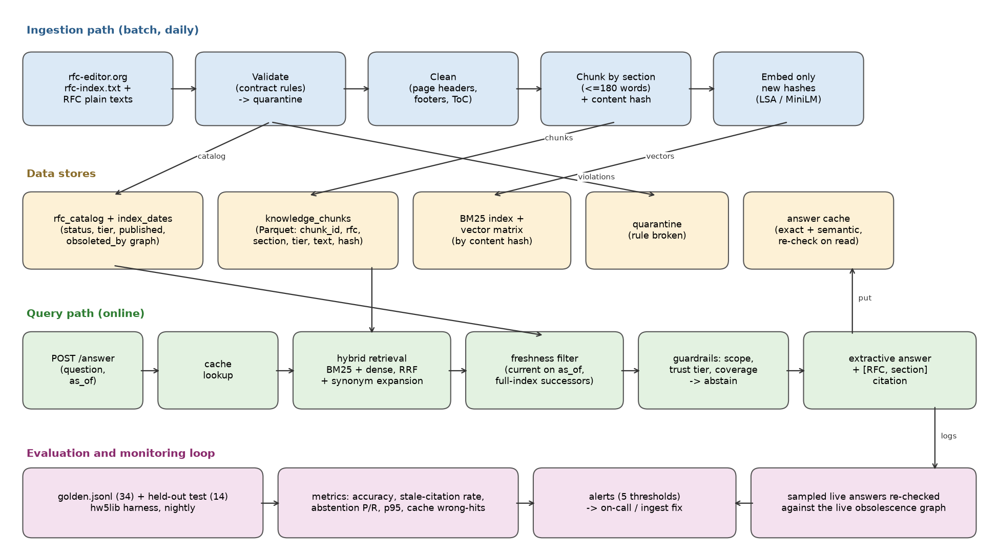

# RFC Assistant: a freshness-aware Q&A system over IETF RFCs

*All numbers come from `python rfc_assistant/evaluate.py` (files in `rfc_assistant/outputs/`). **Hardware for every timing:
Windows 11 laptop, AMD64, 12 logical CPUs, Python 3.13.14, one run.** Correctness numbers were also reproduced
exactly on a second machine (Linux x86_64, 2 vCPUs).*

**Use case in one line.** Network and protocol engineers ask "what does the *current* spec say about X?"
and get a quoted sentence with the RFC number and section, or an explicit "not covered". The domain's
characteristic failure is answering from an *obsolete* RFC. RFCs are never edited; they are replaced by
newer RFCs ("obsoleted by"), so the same question has different correct answers on different dates.
This differs from the Northbeam support assistant in domain (internet standards, not retail), data (public RFC texts and the RFC
index, not a help center) and failure modes: obsolescence chains, successors missing from the corpus,
April-1st joke RFCs, and legacy RFCs with no status.

---

## 3.1 Requirements and scale

### 3.1.1 Users and functional requirements
**Users:** protocol implementers, SREs/network operators and students who need the authoritative wording
of a standard. **Decision supported:** "is my implementation/configuration consistent with the spec that is in
force today (or on a given date)?"

| ID | Functional requirement |
|---|---|
| FR1 | Answer a protocol question with an extracted sentence from an RFC plus its citation `[RFC n, section]`. |
| FR2 | Answer *as of* a date: only RFCs current on that date (published, and not obsoleted) may be retrieved or cited. |
| FR3 | Abstain when the corpus does not cover the question, when the only evidence is an April-1st joke RFC, or when the only source has been obsoleted by an RFC that is not in the corpus. |
| FR4 | Ingest new RFCs and obsolescence changes from the RFC index incrementally (daily). |
| FR5 | Expose search (top-k sections with status and currency flags) for tools and auditing. |

### 3.1.2 Non-functional requirements (targets, origin, and measured value)
| Requirement | Target | Where the target comes from | Measured (prototype) |
|---|---|---|---|
| Stale-citation rate | **0** | Quoting an obsolete spec is a wrong answer in this domain (e.g. RFC 2616's 413 phrase in 2024). | 0.000 golden, 0.000 held-out |
| p95 latency of `/answer` | ≤ 300 ms | Interactive search budget; under ~0.3 s feels instant. | 99.8 ms (240 RFCs, uncached) |
| Freshness | new RFC / obsolescence visible ≤ 24 h | The RFC Editor republishes `rfc-index.txt` daily. | full rebuild incl. BM25 + LSA fit: 47.5 s |
| Answer accuracy (held-out) | ≥ 0.60 | Below this an engineer would still have to read the RFC every time. Baseline is 0.14. | **0.50: not met** |
| Abstention | recall ≥ 0.9 at precision ≥ 0.8 | For normative text a confident wrong answer is worse than "not covered". | golden 1.00 / 0.91; held-out **0.80** / 0.80 |
| Cost | ≤ $0.01 per 1,000 queries | Design constraint: CPU only, no paid API. | ≈ $0.001 / 1k (67 ms per query × 1,000 = 0.019 vCPU-hours at an assumed $0.05 per vCPU-hour) |

### 3.1.3 Scale estimate for a realistic deployment
Assumptions are marked *(A)*; values measured on the prototype corpus are marked *(M)*.

```
sources   RFC index: 9,806 entries (M) -> ~9,500 published RFC texts (A: ~3% "not issued")
          words per RFC 1,457,830 / 240 = 6,074 (M); chunks per RFC 9,377 / 240 = 39 (M)
          errata ~8,000 x 1 chunk (A); active Internet-Drafts ~2,500 x 30 chunks (A)
chunks    9,500 x 39 + 8,000 + 2,500 x 30  = 370,500 + 8,000 + 75,000  ≈ 455,000
vectors   455,000 x 384 dims x 4 B = 0.70 GB (MiniLM)   | x 768 dims = 1.40 GB
text      9,500 x 6,074 words ≈ 58 M words ≈ 0.35 GB raw text for BM25
peak QPS  40,000 engineers x 4 queries/day, 50% in 3 busy hours
          = 40,000 x 4 x 0.5 / (3 x 3,600) = 7.4 QPS; x3 burst ≈ 22 QPS (A)
daily     ~1 new RFC/day x 39 chunks = 39 chunks (A); obsolescence = metadata only, no re-embedding
          drafts: ~60 revisions/day x 30 chunks = 1,800 re-chunked; with hash dedup ~40% changed
          -> ~720 chunks re-embedded/day (A)
```
**Consequences.** Everything fits in memory on one node, and daily ingestion is tiny, so no queue or
streaming is needed. Exact dense scoring over 455k vectors (~175 M multiply-adds per query) would cost
roughly 20–40 ms per query on one core *(A)*. At 22 QPS that calls for an ANN index (HNSW) or 3–4
replicas. The obsolescence check is a graph lookup over ~10k nodes and stays negligible.

---

## 3.2 Design

### 3.2.1 High-level design


*Ingestion* (batch, daily): rfc-index + RFC texts → validation with quarantine → cleaning (page
headers/footers, table of contents) → section-aware chunking → embedding of new content hashes only.
*Stores*: catalog + full-index publication dates (the obsolescence graph), `knowledge_chunks` (Parquet), BM25 +
vector index, quarantine, answer cache. *Query path*: cache → hybrid retrieval → freshness filter →
guardrails (scope, trust tier, coverage) → extractive answer with citation. *Evaluation/monitoring*: nightly
harness runs on the golden and held-out sets, plus sampled live answers re-checked against the live
obsolescence graph.

### 3.2.2 API
| Endpoint | Request | Response |
|---|---|---|
| `POST /v1/answer` | `question: str`, `as_of: date = today`, `max_sentences: int = 2` | `answer: str`, `citations: [{chunk_id, rfc, section, title, status, tier}]`, `abstained: bool`, `reason: "low_coverage" \| "out_of_scope" \| "no_current_source" \| null`, `confidence: float`, `served_from_cache: bool`, `latency_ms` |
| `POST /v1/search` | `query: str`, `as_of: date`, `k: int = 5`, `tiers: [str] = all` | `results: [{chunk_id, rfc, section, score, current: bool, obsoleted_by: [rfc]}]` |
| `GET /v1/rfc/{n}/status` | path `n`, query `as_of` | `{rfc, title, status, tier, published, obsoleted_by: [{rfc, published, in_corpus}], current: bool}` |

### 3.2.3 Data model
| Table | Key | Main fields | Versions / freshness |
|---|---|---|---|
| `rfc_catalog` | `rfc` | title, status, tier, published, obsoletes[], obsoleted_by[], updated_by[], source_url, retrieved_at | RFCs are immutable; a new RFC adds edges to the graph |
| `index_dates` | `rfc` | published (for **every** RFC, including those not in the corpus) | lets the system date a successor it has not ingested |
| `knowledge_chunks` | `chunk_id` (`RFC9112#c4`) | doc_id, rfc, title, status, tier, effective_date, obsoleted_by, section, text, content_hash | valid-time model: currency is computed at query time from `as_of` |
| `embeddings` | `content_hash` | model_id, vector | unchanged text is never re-embedded |
| `quarantine` | `rfc` | catalog fields + violation | audit / replay |
| `answer_cache` | normalized question | answer, cited doc ids, created_at, semantic vector | re-validated on every read against `as_of` |

**Freshness rule.** RFC *n* is current on `as_of` iff `published(n) ≤ as_of` and no RFC in
`obsoleted_by(n)` has `published ≤ as_of`. Successor dates come from the full index, not only from
the corpus (see the decision record).

### 3.2.4 Patterns and the requirement each serves
| Pattern | Requirement | Evidence from the runs |
|---|---|---|
| **Ingestion pipeline with a version policy and change detection**: obsolescence graph incl. out-of-corpus successors, content hashes | FR2, FR4, stale-citation = 0 | stale-citation rate 0.375 without the filter → 0.080 with in-corpus successors → **0.000** with the full-index rule (golden) |
| **Hybrid retrieval**: BM25 + LSA dense, reciprocal rank fusion, domain synonym expansion | FR1, accuracy | Recall@3 0.750 (BM25 baseline) → 0.917; MRR@5 0.630 → 0.826 |
| **Guardrails**: protocol-scope guard, source-trust tiers, coverage-based abstention | FR3, abstention targets | removing the scope guard: accuracy 0.618 → 0.500, abstention recall 1.0 → 0.8; removing abstention: 0.382 |
| **Answer cache with re-check on read**: exact + semantic tier | latency, cost | p50 46.3 ms → 0.10 ms at 83% hits; re-check prevents **10** stale TLS 1.3 answers after RFC 9846 |

**Considered and rejected: an LLM generator behind a model router.** Normative text depends on exact
wording ("MUST" vs "SHOULD", "512 octets" vs "512 characters"), and a paraphrase can change the meaning. The
design budget rules out paid APIs and GPUs, and a local model would multiply latency and cost by ~100× *(A)* for
little gain on short factual questions. A **circuit breaker** was also left out: the query path makes
no remote calls, so nothing can fail independently of the service.

---

## 3.3 Prototype

### 3.3.1 Data provenance
| Item | Value |
|---|---|
| Source | RFC Editor, `https://www.rfc-editor.org/rfc/rfcN.txt` and `rfc-index.txt` |
| License | IETF Trust Legal Provisions: RFCs may be freely reproduced and distributed. The ZIP ships the download script, not the texts. |
| Retrieved | 2026-11-17 (`rfc_assistant/data/catalog.json`); the same 249 RFCs as a first download on 2026-11-16 |
| Selection | 47 core RFCs plus topical matches in the index (HTTP, SMTP, DNS, TLS, TCP/UDP/IP, URI, JSON, WebSocket, FTP, NTP, OAuth, cookies, Telnet …) and their successors; 250 selected, 249 downloaded (RFC 418: HTTP 404) |
| Size | 249 texts, 11.6 MB, 1,457,830 words in the 240 valid RFCs; rfc-index.txt 2.1 MB (9,806 entries) |
| Coverage | RFC 97 (Feb 1971) to RFC 9114 (Jun 2022). Status: 155 UNKNOWN (pre-1983), 30 Proposed, 25 Internet Standard, 18 Historic, 6 Informational, 5 Draft, 1 Experimental. Three April-1st RFCs (748, 1149, 2324). |
| Reproduce | `python rfc_assistant/download_data.py` then `python rfc_assistant/ingest_new.py` |

### 3.3.2 Ingestion (`rfc_assistant/ingest_new.py`)
pandas is used instead of Spark: 240 documents and 9,377 chunks (11.6 MB of text) fit comfortably in memory, and the
whole system build, including the BM25 index and the LSA fit, takes 47.5 s on a laptop. That is three orders of
magnitude below where one machine stops coping. The stages mirror the Q1 Spark pipeline
one-to-one, so the code can be ported if the corpus grows to the full ~9,500-RFC archive.
- **Validation → quarantine:** missing or empty text, missing title, unparseable date, unknown status,
  implausibly short document (< 300 words), duplicate RFC number. Result: **9 quarantined**, all
  "implausibly short" (one-page notes such as RFC 456, 1119).
- **Finding during the build:** the first version also quarantined **155 legacy RFCs** whose status is `UNKNOWN`,
  which left only 85 documents. Those RFCs pre-date the IETF status system, so `UNKNOWN` is a real value, not
  bad data. They now form a low-trust `legacy` tier (weight 0.45).
- **Cleaning:** byte-order mark, running page headers, `[Page N]` footers, form feeds, table of contents.
- **Chunking:** by numbered section heading, ≤ 180 words, each chunk prefixed with `RFC n: title` and
  `## section`. References, acknowledgements, author addresses and copyright sections are skipped.
- **Freshness:** the obsolescence rule above, with successor dates from `rfc-index.txt` (saved as
  `data/index_dates.json` so it also works without `raw/`).

### 3.3.3 Query path (`rfc_assistant/system_new.py`)
BM25 and LSA dense lists (TF-IDF + SVD 256, fitted on the chunks) are fused with RRF (k = 60) over a
synonym-expanded query. Only chunks current on `as_of` are scored, and tier weights are applied (standards 1.0,
informational 0.7, experimental 0.5, historic/legacy 0.45, April-1st 0.15). The answer step:
1. drops April-1st chunks from the evidence (they stay retrievable for audit);
2. **scope guard**: when the question names a protocol (TCP, TLS, DNS, …), keeps only chunks whose RFC title is
   about that protocol;
3. abstains if idf-weighted coverage of the question's terms by the top-3 chunks is < 0.6;
4. extracts the best one or two sentences from the top-5 chunks. Sentences are scored by question overlap plus a
   section-heading bonus and a number bonus for quantitative questions; ASCII-art/ABNF fragments are skipped.
   The answer carries `[RFC n, section …]` and cites the chunk.

### 3.3.4 Production pattern: answer cache, measured
Replay of 300 queries in two phases: 150 asked on 2024-06-01, then 150 on 2026-11-01. Between them RFC 9846
(July 2026) obsoletes RFC 8446 (TLS 1.3). The queries are golden questions and paraphrases, with frequent repeats.

| Cache | τ | L1 hits | L2 hits | p50 ms | p95 ms | wrong-hit rate | stale answers served |
|---|---|---|---|---|---|---|---|
| none | – | 0 | 0 | 46.25 | 89.49 | – | 0 |
| exact + semantic, **re-check on read** | 0.90 | 0.777 | 0.060 | 0.05 | 98.03 | 0.044 | **0** |
| exact + semantic, **re-check on read** (shipped) | 0.95 | 0.810 | 0.020 | 0.10 | 73.29 | 0.024 | **0** |
| exact + semantic, no re-check | 0.90 | 0.810 | 0.060 | 0.02 | 67.35 | 0.080 | **10** |
| exact + semantic, no re-check | 0.95 | 0.843 | 0.020 | 0.01 | 38.66 | 0.062 | **10** |

Reading the table:
- The cache removes the median cost (46.3 ms → ≤ 0.1 ms).
- The effect on the tail is **not robust**. Here p95 improves at τ = 0.95 (89.5 → 73.3 ms) but gets worse at τ = 0.90
  (98.0 ms). On the second machine (Linux, 2 vCPUs) p95 was worse at both thresholds (17.6 → ~25 ms). At ~83% hits the
  slowest 5% are all misses, and a miss pays for the semantic lookup and then the full answer. *Measured, one run per machine.*
- Without the re-check, 10 phase-2 answers cite RFC 8446 after it was obsoleted. With the re-check, none do.
- τ = 0.95 halves the wrong-hit rate for a 4-point lower L2 hit rate, so τ = 0.95 is shipped.

---

## 3.4 Evaluation and engineering decision

### 3.4.1 Labelled sets
- **`golden.jsonl`, 34 questions**: 20 answerable, 4 stale traps, 10 unanswerable. They were written from the RFC texts *before*
  the system was first run and never edited afterwards. `make_golden.py` checks every label automatically: the
  `answer_key` must occur verbatim in the gold RFC, and the gold RFC must be current on `as_of`.
- **Domain hard cases:**
  - 4 stale-trap pairs, the same question on two dates: JSON 4627 → 8259 ("serialized object or array" →
    "serialized value"), HTTP 413 2616 → 9110 ("Request Entity Too Large" → "Content Too Large"), SMTP 821 → 5321
    ("512 characters" → "512 octets"), NTP 1305 → 5905 ("currently three" → "currently 4").
  - 2 joke-RFC-only questions (avian carriers, BREW).
  - 2 successor-outside-the-corpus questions (TCP after RFC 9293, TLS 1.3 after RFC 9846).
  - 1 "not yet defined" question (HTTP 422 in 2010).
  - 1 question whose only other source is a joke (HTTP 418 → "reserved" in RFC 9110).
- **`golden_test.jsonl`, 14 held-out questions** (8 answerable, 1 stale trap, 5 unanswerable). Written and frozen (sha1
  `3a0c9d3888406afabdd8f1c5e4c954b0eab9d12a`) after the first golden run and **before** any change to the
  system. Evaluated once. This is the unbiased number; the v2 golden numbers are optimistic because v2 was
  written after seeing v1's golden failures.

### 3.4.2 Baseline vs. system, ablations, latency
Golden set (34 q):

| System | Acc. | Answerable | Stale trap | Unanswerable | Stale-citation rate | Abstain P / R | Cit. precision | R@3 | MRR@5 |
|---|---|---|---|---|---|---|---|---|---|
| Baseline: BM25, no filter, never abstains | 0.147 | 0.25 | 0.00 | 0.0 | 0.412 | – / 0.0 | 0.382 | 0.750 | 0.630 |
| v1: original system | 0.500 | 0.35 | 0.50 | 0.8 | 0.083 | 0.80 / 0.8 | 0.708 | 0.917 | 0.826 |
| **v2: final system** | **0.618** | 0.50 | 0.25 | 1.0 | **0.000** | 0.91 / 1.0 | 0.913 | 0.917 | 0.826 |
| v2 − scope guard | 0.500 | 0.40 | 0.25 | 0.8 | 0.000 | 0.80 / 0.8 | 0.708 | 0.917 | 0.826 |
| v2 − trusted evidence | 0.618 | 0.50 | 0.25 | 1.0 | 0.000 | 0.91 / 1.0 | 0.913 | 0.917 | 0.826 |
| v2 with in-corpus successors only | 0.559 | 0.50 | 0.25 | 0.8 | 0.080 | 0.89 / 0.8 | 0.840 | 0.917 | 0.826 |
| v2 − freshness filter | 0.471 | 0.35 | 0.25 | 0.8 | 0.375 | 0.80 / 0.8 | 0.625 | 0.792 | 0.663 |
| v2 − source tiers | 0.588 | 0.45 | 0.25 | 1.0 | 0.000 | 0.91 / 1.0 | 0.913 | 0.917 | 0.830 |
| v2 − abstention | 0.382 | 0.55 | 0.25 | 0.1 | 0.000 | 1.00 / 0.1 | 0.667 | 0.917 | 0.826 |

Held-out test (14 q, run once):

| System | Acc. | Answerable | Stale trap | Unanswerable | Stale-citation rate | R@3 |
|---|---|---|---|---|---|---|
| Baseline | 0.143 | 0.250 | 0.0 | 0.0 | 0.357 | 0.778 |
| v1 | 0.429 | 0.375 | 0.0 | 0.6 | 0.091 | 0.889 |
| **v2** | **0.500** | 0.375 | 0.0 | 0.8 | **0.000** | 0.889 |

Latency (golden × 4 = 136 timed calls after 10 warm-up calls, uncached, one run on the Windows laptop above):

| System | p50 ms | p95 ms |
|---|---|---|
| Baseline | 6.4 | 16.5 |
| v1 | 34.7 | 60.0 |
| v2 | 67.4 | 99.8 |

v2 roughly doubles v1's latency. It filters the whole candidate list and scores sentences in five chunks instead of four;
this attribution is *assumed*, since those costs were not isolated. All three stay well inside the 300 ms budget.
System build: 47.5 s.

**What the evidence shows and does not show:**
- The freshness rule and the scope guard carry most of the gain.
- Trusted evidence changed nothing on these sets. The scope guard and coverage test already block the joke RFCs, so it is defence in depth with no measured effect.
- v2 does *worse* than v1 on the golden stale traps (1/4 vs 2/4): its number preference picked a port sentence for the NTP version question.
- With 34 and 14 questions, one question is worth 3 and 7 points respectively, so differences under ~10 points are within noise.

### 3.4.3 Five failures of v2
| # | Example(s) | Category | What happened | What I would change |
|---|---|---|---|---|
| F1 | Q3-S02 (HTTP 413 phrase) | **Distractor section** | RFC 9112's generic "Status Line / reason-phrase" section shares the question's words and outranks the 9110 section titled "413 Content Too Large". | Field-weighted BM25 that boosts section headings and exact numeric identifiers (status codes, ports). |
| F2 | Q3-A06 (IPv6 address size), Q3-S04/A19 (NTP version), test A01 (DNS over UDP) | **Right RFC, wrong passage / answer-type confusion** | The answer chunk is ranked 2–5. The number bonus prefers *any* number, e.g. the NTP port 123 for a version question. | Typed answer slots (version → "version" + digit; size → digit + unit), or a small cross-encoder reranker on the top 10. |
| F3 | Q3-A02 (DNS label), test A05 (IPv4 length) | **False abstention (vocabulary gap)** | The wording "maximum length" / "how long" does not occur in the answer text ("size limits", "fixed length of four octets"), so coverage falls below 0.6. | A size/length/limit synonym group; per-type thresholds tuned on a larger dev set. |
| F4 | test U02 (DNS over HTTPS) | **False answer on an out-of-corpus extension** | The scope guard passes (the question names DNS), and the generic words "queries" and "encode" give enough coverage, so it answers from RFC 1034. | Require the *rarest* question term (here "https"/"over https") to occur in the cited chunk; flag known out-of-corpus extensions. |
| F5 | Q3-A16/S01 (JSON single value), test A08/S01 (IPv6 extension headers) | **Yes/no and comparison questions** | A single extracted sentence is related but not decisive. ABNF fragments with letters pass the noise filter. | Detect yes/no questions and prefer definitional sentences ("A JSON text is …"); strip ABNF lines at ingestion. |

### 3.4.4 Engineering decision record: date successors from the full RFC index
**Context (measured).** Freshness is the requirement that defines this domain (FR2, stale-citation target 0). The first rule
only counted successors that are *inside* the corpus. RFC 793 (TCP) was obsoleted by RFC 9293 in Aug 2022, and RFC 8446
(TLS 1.3) by RFC 9846 in Jul 2026; neither successor is in the corpus, so the system kept quoting both as current.
On 2024-06-01 this affects 3 RFCs (793, 1738, 1866), and on 2026-11-01 4 (plus 8446) *(measured, `current_docs`)*.

**Options.**
1. No freshness filter.
2. Only successors in the corpus (original).
3. Successors dated from the full `rfc-index.txt`, abstaining when the only source is obsolete (chosen).
4. Ingest every successor automatically (not evaluated; it pulls in documents outside the topic scope).

**Decision.** Option 3: `current_docs(..., successors="index")`, with index dates persisted to `data/index_dates.json`.

**Evidence.**
| Rule | Golden acc. | Stale-citation rate | Unanswerable acc. | Label |
|---|---|---|---|---|
| no filter | 0.471 | 0.375 | 0.8 | measured |
| in-corpus successors | 0.559 | 0.080 | 0.8 | measured |
| **full-index successors** | **0.618** | **0.000** | **1.0** | measured |
| held-out, v2 with full index | 0.500 | 0.000 | 0.8 (TCP Urgent Pointer correctly abstained) | measured |

**Consequences.**
- Questions about TCP (any date after Aug 2022) and TLS 1.3 (after Jul 2026) now abstain until RFC 9293 and 9846 are ingested. That is a coverage gap, but an honest one *(measured: Q3-U08, U09 abstain)*.
- Correctness now depends on the daily index sync; a stale index silently reverts to the old behaviour *(assumed)*.
- The rule itself costs one dictionary lookup per successor, cached per `as_of` *(assumed negligible; not isolated from the v2 latency increase)*.

**Next.**
- Measure how many live questions abstain with reason `no_current_source`. A high share means the successors should be ingested, which is option 4 restricted to successors of in-corpus RFCs.
- Measure how often `updated_by` (partial updates, not obsolescence) changes an answer. The current rule ignores it *(assumed risk)*.

**Monitoring plan.**
| Metric | How | Alert threshold |
|---|---|---|
| Stale-citation rate | 1% of live answers re-checked against the current obsolescence graph | > 0 in any day |
| Index freshness lag | hours since the last successful `rfc-index.txt` sync | > 24 h |
| Abstention rate (and share with reason `no_current_source`) | live traffic, daily | > 35% overall, or a change of > 10 points week-over-week |
| p95 latency of `/v1/answer` | service metrics | > 300 ms for 10 min |
| Held-out accuracy (nightly harness run) | `evaluate.py` on `golden_test.jsonl` | drop of > 7 points (one question) vs the last release |
